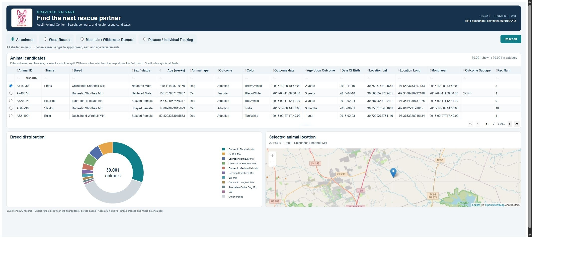
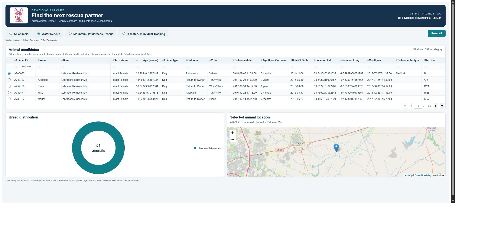
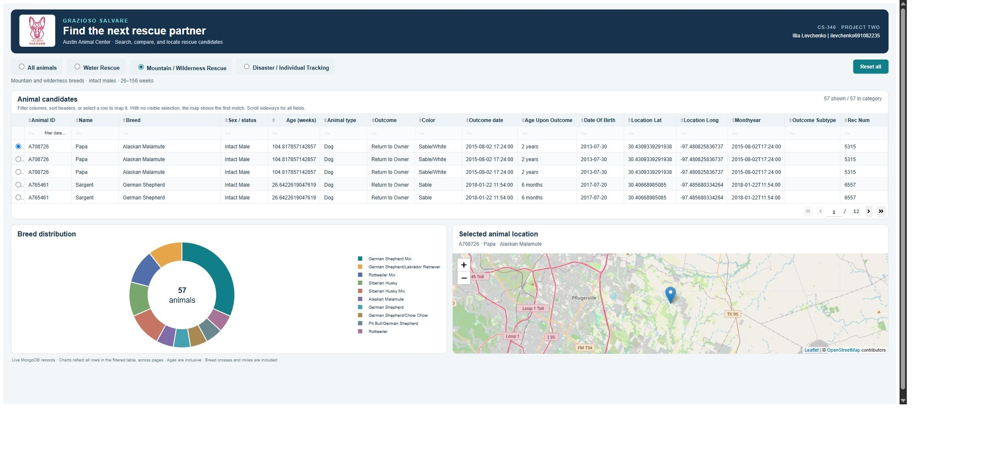
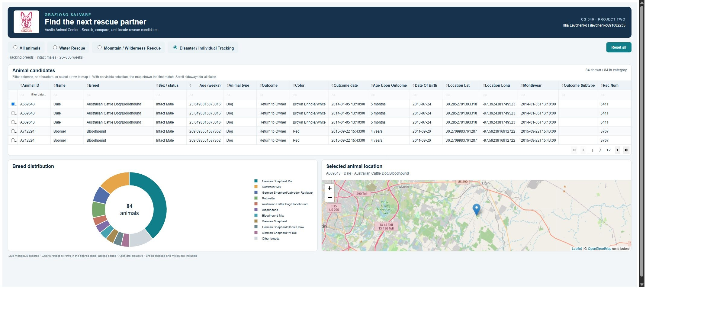
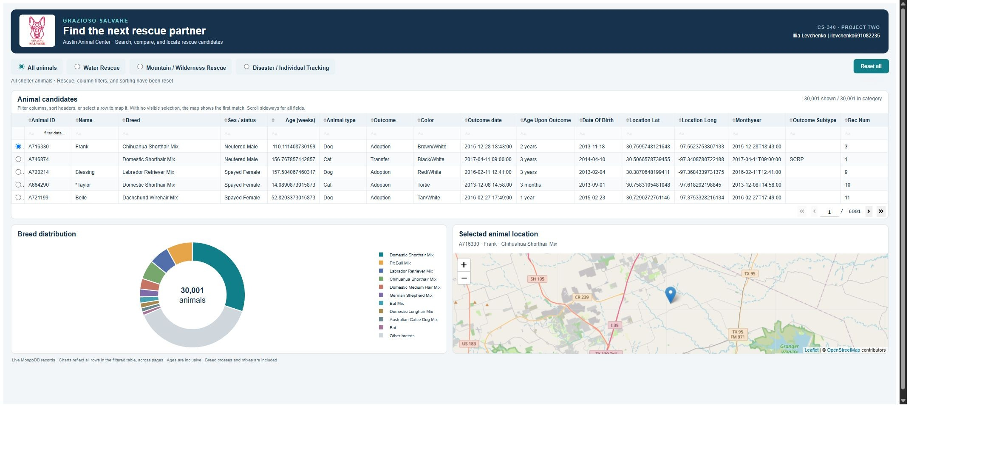

# Grazioso Salvare Rescue Dashboard

Project Two README | CS 340 Client Server Development

Illia Levchenko | October 12, 2026

## Purpose and functionality

This project helps Grazioso Salvare find dogs in Austin Animal Center records that meet the breed, sex, and age requirements for rescue training. The dashboard connects MongoDB to an interactive table, a breed distribution chart, and a map of the selected animal. This README explains the implementation, how to reproduce it, and the results observed in the course Codio environment.

The initial view reads every record in aac.animals. Users can choose Water Rescue, Mountain / Wilderness Rescue, or Disaster / Individual Tracking; add column filters; sort multiple columns; browse pages; and select a record to update the map. The Reset all button reloads the full dataset, clears the filters and sorting, returns to the first page, and selects its first record. The supplied logo links to Southern New Hampshire University. The header identifies Illia Levchenko and ilevchenko691082235.

## Project files

| File | Responsibility |
| --- | --- |
| ProjectTwoDashboard.ipynb | Complete notebook implementation and JupyterDash launch sequence. |
| dashboard_app.py | Matching standalone implementation with layout, query rules, chart, map, and callbacks. |
| CRUD_Python_Module.py | Unchanged AnimalShelter CRUD class reused from the earlier module. |
| Grazioso Salvare Logo.png | Provided logo shown in the dashboard header. |
| requirements.txt | Course package versions and compatible Flask and Werkzeug constraints. |
| aac_shelter_outcomes.csv | Original course dataset containing 10,000 source rows. |
| test_dashboard.py and validation.log | Automated behavior checks and the saved output of the final Codio test run. |
| README.md and screenshots | Portable documentation and five screenshots from the running application. |

## Rescue eligibility rules

Every rescue category requires animal_type equal to Dog. The numeric age_upon_outcome_in_weeks field is checked with inclusive lower and upper bounds. All animals uses an empty query and includes every species. Breed matching is case insensitive and permits listed phrases within mixes and slash separated crosses. Labrador Retriever Mix remains the specific Water Rescue phrase; plain Labrador Retriever does not match it.

| Category | Breed phrases | Sex and age |
| --- | --- | --- |
| Water Rescue | Labrador Retriever Mix; Chesapeake Bay Retriever; Newfoundland | Intact Female<br>26 to 156 weeks |
| Mountain / Wilderness Rescue | German Shepherd; Alaskan Malamute; Old English Sheepdog; Siberian Husky; Rottweiler | Intact Male<br>26 to 156 weeks |
| Disaster / Individual Tracking | Doberman Pinscher; German Shepherd; Golden Retriever; Bloodhound; Rottweiler | Intact Male<br>20 to 300 weeks |

## Architecture and tool choices

The application separates Model View Controller responsibilities. MongoDB and AnimalShelter form the model, handling authentication and queries. Dash components form the view. Callbacks act as the controller, turning category and table interactions into refreshed records and visualizations.

MongoDB stores shelter outcomes as documents with descriptive fields, numeric age, and coordinates. PyMongo translates Python dictionaries into BSON queries for breed matching, exact sex and animal type values, and $gte / $lte age bounds. The reusable CRUD module separates database operations from interface code.

Dash supplies the Python layout and callbacks. DataTable provides filtering, sorting, selection, and pagination. Plotly draws the breed distribution doughnut chart; breeds beyond the ten largest groups form Other breeds without changing the total. dash-leaflet displays OpenStreetMap tiles and a marker at the selected record coordinates.

JupyterDash serves the application through the Jupyter proxy in Codio. The standalone script also supports a regular Dash server. These tools keep the database, interface, and callback logic in Python and accept the returned dictionaries directly.

## How records reach the visualizations

A category change calls load_records and opens AnimalShelter with authSource admin. build_query constructs the filter and read returns its matches. normalize_records converts ObjectId and other non JSON values, preserving each MongoDB _id as a stable string row id. The connection then closes. The dashboard uses read; the module also supports create, update, and delete.

The chart consumes derived_virtual_data, including all column filtered records across table pages. selected_row_ids preserves map selection after sorting. If that selection disappears, the first matching record supplies the map. An initial None state differs from a genuine empty result, which stays empty.

The map validates location_lat and location_long as finite numbers within geographic bounds. Missing or invalid coordinates produce no marker. Database failures display a connection message and unavailable visualizations rather than a successful zero result.

## Reproduce the environment

The application was verified with Python 3.11.2, Dash 2.8.1, JupyterDash 0.4.2, dash-leaflet 0.1.23, Plotly 5.14.1, and PyMongo 4.13.2. requirements.txt also constrains Flask and Werkzeug below version 2.3 for compatibility with this Dash release. Keep the notebook, script, CRUD module, and logo in the same directory.

Copy or extract ProjectTwoDashboard into the Codio workspace/code_files directory. In its terminal, change into that directory. Install requirements if the course environment does not already contain them:

```bash
cd ~/workspace/code_files/ProjectTwoDashboard
python3 -m pip install -r requirements.txt
```

MongoDB must run on localhost port 27017. The dashboard reads database aac and collection animals with username aacuser, password 12345, and authSource admin. The authentication database is where the account was created; it differs from the aac data database. Reuse the existing course database and account when they are already configured.

For a fresh database, import the included CSV once using an account authorized to write aac.animals. The following command prompts for the course password. An administrator must perform the import if aacuser has read access only:

```bash
mongoimport --host localhost --port 27017 \
  --username aacuser --password \
  --authenticationDatabase admin \
  --db aac --collection animals --type csv \
  --headerline --file aac_shelter_outcomes.csv
```

If the course account does not exist, an administrator can create aacuser in admin with a read role on aac after loading the data. Do not recreate an existing user or import repeatedly into a populated collection. Age and coordinates must remain numeric for range queries and mapping. OpenStreetMap tiles require an internet connection.

The included source CSV has 10,000 rows, while the live course database used for verification contains 30,001 documents. The application preserves those records without deduplication. Counts describe database documents rather than unique animals. Historical outcomes can repeat an animal identifier, and repeated imports can duplicate source rows. A clean import therefore need not match the live totals shown here.

## Launch and use the dashboard

Open ProjectTwoDashboard.ipynb in Codio JupyterLab and run its cells in order. The notebook defines the implementation, creates the JupyterDash app, and starts it on port 8052. Open the generated link or the Jupyter proxy path /proxy/8052/ for the full dashboard. Restart the kernel before rerunning if its previous server still owns the port. Port 8052 avoids the earlier module dashboard on port 8051.

For a standalone server, run the following command from the project directory. Browse to http://127.0.0.1:8052 on the same computer, or use the course preview for that port in Codio. The standalone script also accepts a PORT environment variable.

```bash
python3 dashboard_app.py
```

Choose a rescue category to load its eligible records. Enter text or numeric comparisons in the table filter row, click headers to sort, and use the page controls to browse. Select a row with its radio control to update the animal label and map marker. Click Reset all to clear the category, column filters, sorting, and page position and restore the first record of the full dataset.

## Development decisions and fixes

The work reused the existing CRUD module and divided dashboard behavior into query, normalization, selection, chart, map, and application functions. This supports the notebook, standalone server, and automated checks while avoiding a database connection just from importing the script.

Stable MongoDB identities solve the problem of mapping a selected row after reordering or when animal_id repeats. String conversion makes ObjectId serializable for Dash. Breed word boundaries include documented mixes without matching unrelated words, and inclusive numeric bounds preserve records at the exact age limits. Native table filtering feeds the chart across pages instead of limiting it to the five rows shown on one page.

Empty results and database failures receive separate handling. This avoids restoring all records when a user filter returns zero rows and avoids presenting failed database access as valid empty data. Coordinate validation prevents false map markers. A dedicated Reset all button also clears column filters when All animals is already selected; changing a radio option alone would not cover that case.

## Verification results

The final Codio run passed all 17 automated tests in 2.070 seconds. The saved validation.log records the actual test output. The executed notebook contains five executed code cells and no error outputs. The reused CRUD module was also checked against the earlier module and is byte for byte unchanged.

Live MongoDB queries returned the following document counts, matching the displayed category totals and chart totals. All five screenshots were captured from the running application with the logo, author identifier, table, chart, and map visible.

| View | Matching documents |
| --- | --- |
| Initial view and Reset all | 30,001 |
| Water Rescue | 51 |
| Mountain / Wilderness Rescue | 57 |
| Disaster / Individual Tracking | 84 |

The automated checks exercise inclusive age endpoints, every required breed, sex and species restrictions, breed mixes, repeated animal identifiers, selection after sorting and filtering, missing coordinates, JSON conversion, chart totals, empty views, database error handling, and reset behavior. They use fixtures and mocks without modifying MongoDB. Run them with:

```bash
python3 -m unittest -v test_dashboard.py
```

Live browser checks covered all five captured states. Selecting the second All animals row changed the map label to A746874, an unnamed Domestic Shorthair Mix. Entering NO_MATCH_999 in the Animal ID column filter produced no rows and a no matches map message. Reset all cleared that filter, restored 30,001 records, and selected the first row. Automated checks covered selection after reordering, chart totals across pages, and resetting page position.

## Screenshots of the running application

The figures show the existing live database, including repeated outcome records. Full resolution JPEG files are included in the screenshots directory for closer inspection.



Figure 1. Initial All animals view with 30,001 documents. The logo, author identifier, interactive table, breed chart, and selected animal map are visible.



Figure 2. Water Rescue returns 51 documents for the specified breeds, intact females, and inclusive ages of 26 to 156 weeks.

## Mountain and disaster rescue views



Figure 3. Mountain / Wilderness Rescue returns 57 documents for the specified breeds, intact males, and inclusive ages of 26 to 156 weeks.



Figure 4. Disaster / Individual Tracking returns 84 documents for the specified breeds, intact males, and inclusive ages of 20 to 300 weeks.

## Reset and reuse



Figure 5. Reset all restores the full 30,001 document view and clears rescue and column filters, sorting, and pagination.

The notebook, Python files, requirements, CSV, logo, README, and screenshots form the local project package. No public repository or deployment is implied. Before publishing or adapting the code for production, remove the lab password from source, use environment based secrets, and grant the dashboard account only the permissions it needs. The source data and branding remain subject to their owners' terms.
